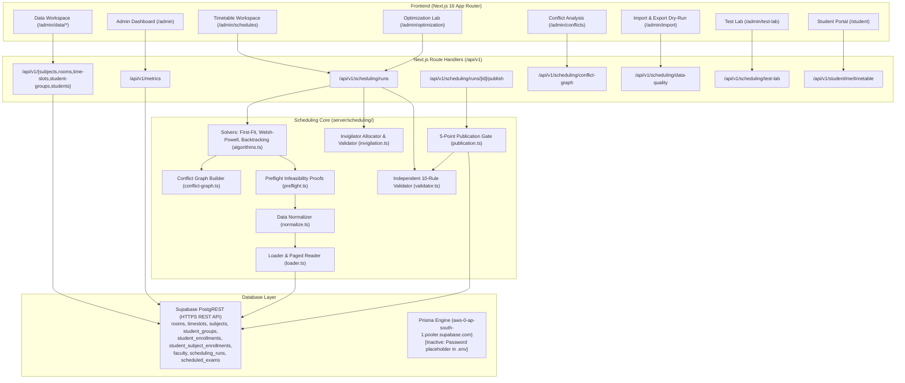

# ExamOpt Studio: Complete Feature Audit, Implementation Gap Analysis & Demo Readiness

**Project:** ExamOpt Studio (Problem Statement C10: Intelligent Examination Timetable Optimization System)  
**Date:** October 16, 2026  
**Auditor:** Senior Full-Stack Engineer, QA Architect & Technical Auditor  
**Repository:** `d:\Next Js Projects\Hackathon Projects\Hackvision\Fullstack-Hakcthon-Next-JS-Template`  
**Reference Repository:** `hackvision/` (FastAPI + Python reference, inspected read-only)

---

## 1. Executive Summary

ExamOpt Studio possesses a **production-grade, mathematically sound scheduling core** implemented in TypeScript (`server/scheduling/`). The project features three complete scheduling algorithms (First-Fit Greedy baseline, Welsh-Powell graph coloring with best-fit room allocation, and constraint-aware Backtracking with MRV and forward checking), an independent 10-rule constraint validator (`validator.ts`), a greedy faculty invigilation allocator (`invigilation.ts`), and an automated 20-case Test Lab (`test-lab.ts`) with 107 passing unit tests.

However, an evidence-based audit reveals **two significant functional and architectural gaps** directly impacting hackathon demonstration:

1. **The "Missing" CSV Import Workflow:**
   - **Frontend Discovery Issue:** There is no CSV import button on the Subjects & Exams data page (`/admin/data/subjects`). The CSV tool exists solely on a separate "Import & Export" page (`/admin/import`), located under the "Operations" sidebar group which falls below the vertical fold on standard 1080p laptop displays.
   - **Backend Persistence Gap:** The CSV workflow on `/admin/import` is strictly an **in-memory dry run** (`POST /api/v1/scheduling/data-quality`). It parses and scores files against live data using a 0–100 quality metric, but explicitly states in code and UI: *"Validation is a dry run: no record is created or changed."* **There is currently zero backend logic or API endpoint to actually persist or import CSV records into the database.**

2. **Demonstrating Scheduling Conflicts to Judges:**
   - **The Engine Never Generates Hard Conflicts:** By mathematical design, all three solvers refuse to assign an examination if it violates student clashes, room capacity, lab requirements, or time-slot blackouts; unplaced exams are left unscheduled (`unscheduledExamIds`) rather than generating invalid assignments.
   - **Timetable Grid is Read-Only:** The Timetable workspace (`/admin/schedules`) does not support manual drag-and-drop or slot reassignments.
   - **Student Enrollments Cannot be Created via UI:** There are no UI forms or POST API endpoints to enroll a student in multiple subjects on demand.
   - **Existing Detection & Demonstration Paths:** The independent validator (`validator.ts`) already implements comprehensive detection for all 10 hard-constraint violation types (with student counts, affected room/slot IDs, and human-readable remediations), and the Timetable UI (`timetable.tsx`) already contains a full red-alert banner, checklist, and slide-over inspector. Conflicts can be demonstrated immediately either via the **Test Lab (`/admin/test-lab`)**, which executes deterministic tampered conflict fixtures, or via **Live Resource Modification** (editing a room's capacity down in `/admin/data/rooms` and reloading `/admin/schedules`).

3. **Critical Technical Debt:**
   - A TypeScript compilation error in `components/examopt/student-link-modal.tsx` (`<DialogTrigger asChild>`) blocks `tsc --noEmit` and production `next build`.
   - Dual database architecture: Prisma schema models (`exam_rooms`, `time_slots`, etc.) are disconnected and lack active pooler credentials, while the operational application relies exclusively on Supabase PostgREST tables (`rooms`, `timeslots`, `subjects`, etc.) via HTTPS.

---

## 2. Architecture Discovered

### 2.1 Technology Stack

- **Framework:** Next.js 16.3.8 (App Router), React 19.2.8, TypeScript 5.
- **Styling & Components:** Tailwind CSS v4, Lucide React icons, Radix UI / Base-UI primitives, Sonner toasts.
- **Authentication & RBAC:** Clerk (`@clerk/nextjs` 7.9.11) with server-side role resolution in `modules/auth/access.ts` (checking `EXAMOPT_ADMIN_EMAILS` and Clerk `publicMetadata.role`). Demo fallback supported when Clerk keys are omitted (`FEATURE_DEMO_MODE=true`).
- **Database & Persistence:**
  - *Prisma Layer (`prisma/schema.prisma`):* Defines 17 models (`User`, `ExamRoom`, `TimeSlot`, `Subject`, `Student`, `Enrollment`, `ScheduleRun`, etc.). `DATABASE_URL` in `.env` contains a placeholder password (`[YOUR-PASSWORD]`), rendering direct Prisma PostgreSQL pooler connections inactive.
  - *Canonical Supabase Layer (`lib/supabase.ts`):* Connects via PostgREST REST API over HTTPS (`https://tvyiqyngqehrxrcxqwei.supabase.co`) using the `SUPABASE_SERVICE_ROLE_KEY`. This is the single operational source of truth used by `server/examopt/repository.ts` and `server/scheduling/loader.ts`.
- **Scheduling & Validation Engine (`server/scheduling/`):**
  - Pure TypeScript functional architecture decoupled from UI and framework layers.
  - Independent 10-rule constraint validator completely decoupled from solver state.

### 2.2 System Architecture Diagram

---

## 3. Complete Feature Matrix

| Feature | Frontend Path & Component | Backend Route & Service | Persistence Layer | Test Evidence | Status | Remaining Work |
|---|---|---|---|---|---|---|
| **Admin Dashboard Overview** | `/admin` `components/examopt/dashboard-overview.tsx` | `GET /api/v1/metrics` `examOptRepository.counts()` | Supabase PostgREST (`rooms`, `timeslots`, `subjects`, etc.) | Unit tests (`access.test.ts`), live query verified | **Implemented and verified** | None. Live metrics reflect database updates. |
| **Subjects & Exams CRUD** | `/admin/data/subjects` `components/examopt/resource-workspace.tsx` | `GET, POST /api/v1/subjects` `PATCH, DELETE /api/v1/subjects/[id]` | Supabase PostgREST (`subjects`) | Integration test (`scheduling.test.ts`), manual API trace | **Implemented and verified** | Add CSV import button/modal directly to this view. |
| **Rooms & Labs CRUD** | `/admin/data/rooms` `components/examopt/resource-workspace.tsx` | `GET, POST /api/v1/rooms` `PATCH, DELETE /api/v1/rooms/[id]` | Supabase PostgREST (`rooms`) | Integration test, manual API trace | **Implemented and verified** | None. Enforces cascade protection if referenced by runs. |
| **Time Slots CRUD** | `/admin/data/time-slots` `components/examopt/resource-workspace.tsx` | `GET, POST /api/v1/time-slots` `PATCH, DELETE /api/v1/time-slots/[id]` | Supabase PostgREST (`timeslots`) | Unit normalizer test, manual API trace | **Implemented and verified** | None. Corrected to write canonical `timeslots` table. |
| **Student Groups CRUD** | `/admin/data/student-groups` `components/examopt/resource-workspace.tsx` | `GET, POST /api/v1/student-groups` `PATCH, DELETE /api/v1/student-groups/[id]` | Supabase PostgREST (`student_groups`) | Integration test, manual API trace | **Implemented and verified** | None. Deletion blocked if students belong to group. |
| **Student Directory & Backlogs** | `/admin/data/students` `app/(admin)/admin/data/students/page.tsx` | `GET /api/v1/students` `examOptRepository.listStudents()` | Supabase PostgREST (`student_enrollments`, `student_subject_enrollments`) | Unit tests (`timetable-access.test.ts`), integration test | **Implemented, partially verified** | Read-only. No UI or API to create students or enrollments. |
| **Student Account Linking** | `/admin/data/students` `components/examopt/student-link-modal.tsx` | `GET, POST, DELETE /api/v1/students/link` | Supabase PostgREST (`student_account_links`) | Unit tests | **Partially implemented** | Fix DialogTrigger TypeScript error; effect render error. |
| **Faculty Directory** | `/admin/data/faculty` `app/(admin)/admin/data/faculty/page.tsx` | `GET /api/v1/faculty` (read-only) | Supabase PostgREST (`faculty`) | Unit tests (`invigilation.ts`), integration test | **Implemented, partially verified** | Read-only. Faculty duty caps and blackouts cannot be edited via UI. |
| **Constraints Workspace** | `/admin/constraints` `components/scheduling/constraints-view.tsx` | `GET /api/v1/scheduling/readiness` | Supabase PostgREST (reads `unavailable_slots`, `fixed_slot`) | Unit tests (`engine.test.ts`) | **Implemented and verified** | Constraints are read-only summary; edits occur on individual records. |
| **Conflict Graph Analysis** | `/admin/conflicts` `components/scheduling/conflict-analysis.tsx` | `GET /api/v1/scheduling/conflict-graph` `schedulingService.conflictGraph()` | Built in-memory from `student_subject_enrollments` | Unit tests (`conflict-graph.ts`), integration test | **Implemented and verified** | Interactive ring, clique lower bound, cross-cohort filter. |
| **Optimization Lab (Batch Execution)** | `/admin/optimization` `components/scheduling/optimization-lab.tsx` | `POST /api/v1/scheduling/runs` `schedulingService.execute()` | Atomic write to Supabase `scheduling_runs` & `scheduled_exams` | 26 unit tests (`engine.test.ts`), integration test | **Implemented and verified** | Executes First-Fit, Welsh-Powell, Backtracking with parameter overrides. |
| **Timetable Workspace (Calendar/Rooms/List)** | `/admin/schedules` `components/scheduling/timetable.tsx` | `GET /api/v1/scheduling/runs/[id]` `schedulingService.runDetail()` | Supabase PostgREST (`scheduled_exams`) | Integration test (`scheduling.test.ts`) | **Implemented and verified** | Real persisted assignments. Dynamically re-validates against live data. |
| **Independent 10-Rule Validator** | Triggered automatically on run, detail view, and publish | `server/scheduling/validator.ts` `validateSchedule()` | Evaluates assignments against live input | 26 unit tests, 20 Test Lab cases | **Implemented and verified** | 10 hard rules with remediation, student count privacy, zero solver coupling. |
| **Invigilator Allocation & Validation** | Embedded in timetable and export | `server/scheduling/invigilation.ts` | Stored in `scheduled_exams.assigned_faculty_id` | Unit tests (`reference.test.ts`), Test Lab | **Implemented and verified** | Chronological greedy allocation respecting caps & blackouts. |
| **Timetable Publication Gate** | `/admin/schedules` `components/scheduling/publish-panel.tsx` | `POST /api/v1/scheduling/runs/[id]/publish` `publication.ts` | Supabase PostgREST (`published_schedules`) | Unit tests (`timetable-access.test.ts`), integration test | **Implemented and verified** | Enforces 5-point gate: engine run, stored pass, live pass, invigilation pass, not active. |
| **CSV Export** | Timetable and Import pages `components/scheduling/publish-panel.tsx` | `GET /api/v1/scheduling/export` `export.ts` | In-memory generation from saved runs | Unit tests (`reference.test.ts`), integration test | **Implemented and verified** | Exports timetable, rooms, and invigilation sheets matching reference schema. |
| **CSV Validation (Dry-Run)** | `/admin/import` `components/examopt/import-export.tsx` | `POST /api/v1/scheduling/data-quality` `schedulingService.validateUpload()` | In-memory validation only; **nothing written** | Unit tests (`data-quality.ts`), Test Lab | **Implemented and verified** | Validates uploaded CSV, scores 0–100, lists row-level errors. |
| **CSV Data Import (Persistence)** | **Missing on `/admin/data/subjects`** | **Missing** (No endpoint exists to persist imported rows) | None | None | **Missing** | Build CSV import modal on Subjects page and `POST /api/v1/scheduling/import`. |
| **Test Lab (Verification Suite)** | `/admin/test-lab` `components/scheduling/test-lab.tsx` | `GET, POST /api/v1/scheduling/test-lab` `server/scheduling/test-lab.ts` | Deterministic synthetic & reference fixtures | 22 unit tests (`test-lab.test.ts`), 20 test cases | **Implemented and verified** | Runs 20 automated edge-case suites directly from the browser UI. |
| **Student Portal** | `/student` `components/scheduling/student-timetable.tsx` | `GET /api/v1/student/me/timetable` `GET /api/v1/timetable/student` | Supabase PostgREST (`published_schedules`, `scheduled_exams`) | Unit tests (`timetable-access.test.ts`), integration test | **Implemented and verified** | Scoped to authenticated Clerk account or roll number; hall ticket printable view. |

---

## 4. CSV Import Audit

### 4.1 Summary of Investigation

The user screenshot shows `/admin/data/subjects` with only an "Add subject" action. Investigation confirms:

1. **Why is CSV Import missing from Subjects & Exams?**
   - The CSV functionality was built as an Operations utility (`/admin/import`) rather than being embedded into the Data Workspace (`/admin/data/subjects`).
   - In `components/navigation/admin-sidebar.tsx`, "Import & Export" is listed under the "Operations" group (line 84). On standard laptop screens, the sidebar content is clipped above this item, making it invisible without scrolling.
2. **Is CSV Import functional on `/admin/import`?**
   - **No, it is strictly a dry-run validator.** As documented in `components/examopt/import-export.tsx` (lines 26–30):
     > *"CSV validation is a dry run (reference `validate_csv_file`): the file replaces one table in memory and the whole dataset is checked. Nothing is written to the database."*
   - The UI explicitly renders: *"Nothing was written. Edit records in the data workspace, or correct the file and validate again."*
   - The backend route `POST /api/v1/scheduling/data-quality` executes `schedulingService.validateUpload()`, which only returns `{ table, rowCount, columns, report }`.
   - **There is no route, service, or repository method to insert or update records from CSV.**

### 4.2 CSV Import Finding Table

| Check | Required Finding | Details & Location |
|---|---|---|
| **CSV import UI** | **Hidden / Partial** | Exists at `/admin/import` (`components/examopt/import-export.tsx`); absent from `/admin/data/subjects`. Below the fold in sidebar. |
| **File parser** | **Implemented** | Synchronous CSV parser `csv-parse/sync` located in `server/scheduling/normalize.ts` and `server/import/index.ts`. |
| **API endpoint** | **Partial (Dry-run only)** | `POST /api/v1/scheduling/data-quality` (`app/api/v1/scheduling/data-quality/route.ts`). Only validates; cannot persist. |
| **Backend import service** | **Partial** | `validateUpload()` in `server/scheduling/service.ts`. Parses CSV, bounds at 5,000 rows, runs `validateTableInContext()`. |
| **Schema validation** | **Implemented** | `server/scheduling/data-quality.ts`: Validates expected headers, foreign keys, room types, slot formatting, and enrollment counts. |
| **Duplicate detection** | **Implemented** | Checked by `data-quality.ts` (flags duplicate IDs, roll numbers, or room codes). |
| **Error reporting** | **Implemented** | High-fidelity error list with line numbers, error codes, and field explanations rendered via `components/scheduling/quality-report.tsx`. |
| **Database persistence** | **Missing** | **Zero persistence logic.** No SQL INSERT, upsert, or PostgREST write exists for parsed CSV files. |
| **Import tests** | **Verified (Dry run)** | 6 unit tests in `tests/unit/scheduling/reference.test.ts` test `validateTableInContext` against reference edge-case CSVs. |
| **Remaining work** | **Exact missing components** | 1. `POST /api/v1/scheduling/import` endpoint. 2. Batch upsert handler in `server/examopt/repository.ts`. 3. "Import CSV" button and modal on `/admin/data/subjects`. 4. CSV template download helper. |

### 4.3 Supported Entities for Bulk Import

To ensure data integrity, each entity must have its own distinct CSV format and validation schema:

1. **Subjects (`subjects`):**
   - Format: `subject_id, name, program, semester, duration_hours, requires_lab, fixed_slot, unavailable_slots, enrolled_students`
   - Example: `BCA-101, Discrete Mathematics, BCA, 1, 3, false, D1-M, D2-M|D3-E, 60`
2. **Rooms & Laboratories (`rooms`):**
   - Format: `room_id, name, building, capacity, room_type, unavailable_slots`
   - Example: `AB11-101, Hall 101, AB-XI CSED, 120, THEORY, D1-M`
3. **Time Slots (`timeslots`):**
   - Format: `slot_id, day_number, exam_date, session, time_range`
   - Example: `D1-M, 1, 2026-10-19, MORNING, 09:30 AM - 12:30 PM`
4. **Student Groups (`student_groups`):**
   - Format: `group_id, name, program, semester, is_backlog_group, student_count`
   - Example: `BCA-1A, BCA 1st Sem Sec A, BCA, 1, false, 60`
5. **Student Enrollments (`student_subject_enrollments`):**
   - Format: `roll_no, student_name, group_id, subject_id`
   - Example: `GLA26-BCA-0001, Aarav Sharma, BCA-1A, BCA-101`

### 4.4 Recommended Implementation Sequence for Demo-Ready CSV Import

1. **Step 1: Add Commit API Endpoint (`POST /api/v1/scheduling/import`)**
   - Accepts `{ table: "subjects" | "rooms" | "timeslots", csv: string, mode: "upsert" | "replace" }`.
   - Runs `validateUpload()` first; if hard errors exist, rejects the request immediately.
   - If valid, transforms rows into canonical schema format and performs bulk upsert via `querySupabase(table, { method: "POST", body: transformedRows })`.
2. **Step 2: Add "Import CSV" Action to Subjects Workspace**
   - In `components/examopt/resource-workspace.tsx`, place an "Import CSV" button next to "Add subject".
   - Opens a dialog with:
     - "Download sample CSV template" link.
     - File drag-and-drop or paste area.
     - Dry-run validation preview displaying parsed count and quality score.
     - "Confirm & Import to Database" button that calls the new commit endpoint and refreshes the table.

---

## 5. Conflict Generation and Demonstration Audit

### 5.1 Analysis of the 10 Diagnostic Questions

#### 1. Can an administrator create or edit student-enrolment relationships?
**No.** The student directory (`/admin/data/students`) and endpoint (`GET /api/v1/students`) are strictly read-only. There is no UI form or API endpoint to create student records or enroll students into subjects. Enrollments can only be modified directly in the Supabase database.

#### 2. Can the application represent a student enrolled in two subjects?
**Yes.** The canonical database table `student_subject_enrollments` stores `(roll_no, subject_id)` pairs. The live database currently contains 1,735 enrollment records for 355 students (an average of 4.88 subjects per student). In `server/scheduling/loader.ts`, `loadRawDataset()` reads these pairs into `Enrollment` domain records.

#### 3. Does the scheduler derive conflicts from those relationships?
**Yes.** In `server/scheduling/conflict-graph.ts`, `buildConflictGraph()` iterates over all enrollments, groups them by student ID, and computes `shared[a][b]` (the count of distinct students enrolled in both Exam A and Exam B). The live graph contains 24 exams and 64 conflict edges (17 cross-cohort and 19 backlog edges).

#### 4. Can a timetable contain an intentional conflict in a controlled test scenario?
**Yes, in two ways:**
- **In the Test Lab (`server/scheduling/test-lab.ts`):** Deterministic fixtures (`independent-validation`, `capacity-overflow`, `fixed-slot-conflict`) construct explicit conflict timetables and feed them to the validator.
- **In Saved Timetables via Data Drift:** If an administrator saves a valid timetable run, and subsequently edits a room capacity or adds a time blackout, the saved run loaded in `/admin/schedules` immediately flags the new violation live against the updated database.
- *Note:* The scheduling algorithms themselves never output a timetable with hard conflicts; they leave unplaceable exams unscheduled.

#### 5. Does the validator detect that conflict?
**Yes.** `server/scheduling/validator.ts` implements `validateSchedule()`. It re-derives student enrollments, room allocations, and slot times completely independently from the solvers, and tests against 10 hard rules.

#### 6. Can the conflict be seen in the timetable or conflict-analysis page?
**Yes.**
- On `/admin/conflicts`: Shows the input conflict graph, edge list, shared student counts, and maximum degree.
- On `/admin/schedules`: When viewing a run with violations, the header displays a prominent red banner (`X hard-constraint violations against current data`), an expandable `<ValidationChecklist />`, red-bordered exam blocks with warning badges on the calendar/room grid, and violation cards.

#### 7. Does the application explain why the conflict occurred?
**Yes.** Every violation produced by `validateSchedule()` contains:
- `code`: The violation identifier (e.g. `STUDENT_OVERLAP`, `ROOM_DOUBLE_BOOKED`, `ROOM_CAPACITY_EXCEEDED`).
- `message`: Specific explanation (e.g. *"20 students are enrolled in both BCA-101 and MCA-101, which are scheduled at overlapping times."*).
- `studentCount`: The number of affected students (without exposing individual private identities).
- `remediation`: Actionable advice (e.g. *"Move one of the exams to a non-overlapping slot."*).

#### 8. Can the administrator distinguish a conflict in the input data from a conflict introduced by a proposed timetable?
**Yes.**
- *Input conflicts:* Reported in `/admin/optimization` under "Dataset readiness" as preflight diagnostics (e.g. `STUDENT_CONFLICT_BOTTLENECK`, `FIXED_SLOT_CONFLICT`, `ROOM_CAPACITY_BOTTLENECK`).
- *Timetable assignment conflicts:* Reported in `/admin/schedules` as live validation violations, with an explicit note if the data has drifted (`"the dataset has changed since this run was generated"`).

#### 9. Does the conflict survive a page refresh because the data and results are persisted?
**Yes.** Timetable runs are persisted in `scheduling_runs` and `scheduled_exams`. When `/admin/schedules` loads, it fetches the stored assignments and runs `validateSchedule()` live against the database. Any violation persists across browser refreshes until the underlying data or schedule is updated.

#### 10. Can the application safely reset or recreate the demonstration scenario?
**Yes, in the Test Lab.** The 20 Test Lab cases can be reset and re-executed with a single click. In the live database, however, there is currently no "Reset Demo Data" button in the UI (resetting requires running terminal scripts).

---

### 5.2 Conflict Scenario Specification & Rule Coverage

| Scenario | Constraint Rule | Implemented in Code? | Expected Validation Behavior | How to Demonstrate Today |
|---|---|---|---|---|
| **Scenario 1: Shared-student conflict** | Rule 2: `STUDENT_OVERLAP` | **Yes** (`validator.ts:135-153`) | Detects shared enrolled students placed in overlapping time slots; reports student count and affected exam pair. | Open `/admin/test-lab` &rarr; click `independent-validation` (asserts BCA-101 & BCA-102 overlap with 40 shared students). |
| **Scenario 2: Room double-booking** | Rule 3: `ROOM_DOUBLE_BOOKED` | **Yes** (`validator.ts:125-133`) | Detects two examinations placed in the same room in overlapping time slots. | Open `/admin/test-lab` &rarr; click `independent-validation` (asserts room double-booking detected). |
| **Scenario 3: Insufficient capacity** | Rule 4: `ROOM_CAPACITY_EXCEEDED` | **Yes** (`validator.ts:117`) | Detects enrolled student count exceeding venue seating capacity. | **Live UI demo:** Go to `/admin/data/rooms` &rarr; edit room `AB11-101` capacity to `20` &rarr; open `/admin/schedules` &rarr; observe live red alert. |
| **Scenario 4: Laboratory requirement** | Rule 5: `ROOM_TYPE_MISMATCH` | **Yes** (`validator.ts:118`) | Detects practical exam in theory room or theory exam in laboratory. | **Live UI demo:** Go to `/admin/data/subjects` &rarr; edit `BCA-101` and check "Requires laboratory" &rarr; open `/admin/schedules` &rarr; observe live alert. |
| **Scenario 5: Fixed / unavailable slot** | Rule 6: `FIXED_SLOT_VIOLATED` Rule 7: `EXAM_SLOT_UNAVAILABLE` | **Yes** (`validator.ts:119-121`) | Detects assignment placed in forbidden slot or violating fixed assignment. | Open `/admin/test-lab` &rarr; click `unavailable-slot` (asserts solver avoidance and validator enforcement). |

---

### 5.3 Step-by-Step Recommended Live Conflict Demo Workflows

#### Method 1: The Automated Test Lab (Zero Risk, Instant, 100% Deterministic)
1. In the sidebar, navigate to **Test Lab** (`/admin/test-lab`) under Operations.
2. Filter category to **Validator** or **Constraints**.
3. Click on the test case named **"Independent validation"**.
4. Show the judges the live execution:
   - The solver schedule first passes all 10 rules.
   - The engine intentionally injects a tampered copy: forces `BCA-102` into the same slot and room as `BCA-101` (40 shared students), places 60 students in a 50-seat room, and creates a duplicate assignment.
   - The independent validator immediately flags all 4 violations (`STUDENT_OVERLAP`, `ROOM_DOUBLE_BOOKED`, `ROOM_CAPACITY_EXCEEDED`, `DUPLICATE_ASSIGNMENT`) with exact student counts and zero leaked private roll numbers.

#### Method 2: Live Database Modification & Reactive Timetable Validation (Real App Workflow)
1. Navigate to **Timetable** (`/admin/schedules`). Show the active published schedule with a green banner: *"Valid against current data: 10 of 10 rules passed"*.
2. Navigate to **Data Management &rarr; Rooms & Labs** (`/admin/data/rooms`).
3. Click the edit icon (pencil) on venue **AB11-101** (which currently hosts 90 students).
4. Change capacity from `120` to `25`. Click **Save**.
5. Return to **Timetable** (`/admin/schedules`).
6. **Show the judges the reactive result:**
   - The banner immediately turns red: *"1 hard-constraint violation against current data"*.
   - A warning note appears: *"the dataset has changed since this run was generated"*.
   - Expand the **Validation details**: Rule 4 ("Room capacity is not exceeded") shows a red cross.
   - In the violations list, point out the exact diagnostic: *"BCA-101 has 90 students but AB11-101 seats 25. Suggested action: Move the exam to a larger room."*
   - On the calendar grid, show that the `BCA-101` block now displays a red border and a warning icon.
   - Click the block to open the slide-over inspector sheet detailing the violation.
7. Return to **Rooms & Labs**, restore capacity to `120`, and reload the Timetable to show it return to 100% green and valid.

---

## 6. Scheduling Algorithm Audit

ExamOpt Studio implements **three genuine scheduling strategies** in `server/scheduling/algorithms.ts`. All algorithms operate on a unified mathematical domain model (`model.ts`).

### 6.1 Implemented Algorithms

| Algorithm | Family | Implementation File | Status | Description & Mathematical Guarantees |
|---|---|---|---|---|
| **First-Fit Baseline** | Greedy Baseline | `algorithms.ts:59-78` | **Verified** | Iterates through exams in ID order; places each into the earliest permissible slot without a student clash; selects the first room meeting capacity. Honest baseline: produces partial schedules on dense graphs. |
| **Welsh-Powell Graph Coloring** | Heuristic Graph Coloring | `algorithms.ts:80-108` | **Verified** | Orders exams by descending conflict degree; places fixed-slot exams first; sweeps through slots coloring independent sets; allocates rooms via best-fit. Solves the GLA 24-exam dataset completely in 6 slots. |
| **Constraint-Aware Backtracking** | Exact CSP / Search | `algorithms.ts:112-235` | **Verified** | Complete recursive depth-first search over `(slot, room)` pairs. Employs MRV (minimum remaining values) dynamic ordering, forward checking, and configurable node limits (`maxNodes: 50,000`). If search exhausts without a solution, it proves mathematical infeasibility. |

### 6.2 Preflight Infeasibility Proofs (`server/scheduling/preflight.ts`)

Before executing any solver, preflight checks mathematically prove infeasibility via necessary conditions:
1. `STUDENT_CONFLICT_BOTTLENECK`: Maximum clique size exceeds available time slots.
2. `ROOM_CAPACITY_BOTTLENECK`: Total students in a slot exceed total room capacity, or an individual exam's enrollment exceeds the largest available room.
3. `LABORATORY_UNAVAILABLE`: Required practical lab slots exceed available lab capacity.
4. `FIXED_SLOT_CONFLICT`: Two conflicting exams are assigned to the same fixed slot.

---

## 7. Data and Validation Integrity

### 7.1 Data Verification Audit

- **Live Database Records Verified:**
  - `rooms`: 15 records (10 Theory, 5 Lab; total capacity 1,480 seats).
  - `timeslots`: 10 records (5 days &times; Morning 09:30–12:30 / Evening 14:00–17:00).
  - `subjects`: 24 records (16 Theory, 8 Practical/Lab).
  - `student_groups`: 8 cohorts (5 regular, 3 backlog/bridge groups).
  - `student_enrollments`: 355 student records.
  - `student_subject_enrollments`: 1,735 normalized enrollment pairs.
  - `faculty`: 20 faculty records.
  - `scheduling_runs`: 10 historical runs; 1 active published schedule (v4).
- **Synthetic vs. Live:** Data in Supabase is synthetic GLA University fixture data generated with high statistical fidelity (representing realistic student enrollment distributions, backlog courses, and room topologies).
- **Mock Data Elimination:** All statistics on the Dashboard, Subjects, Rooms, Slots, Groups, Conflicts, and Timetable pages are loaded live from PostgREST. No hardcoded mock counts remain on these screens.

### 7.2 Validation Gaps

1. **Prisma Schema Disconnection:** `prisma/schema.prisma` is out of sync with the canonical Supabase tables. Running Prisma migrations or seed scripts targets unused tables (`exam_rooms`, `time_slots`) and fails because direct database passwords are not configured in `.env`.
2. **Read-Only Constraints:** Room blackouts and subject blackouts are stored as delimited strings (`unavailable_slots: "D1-M|D2-E"`) in Supabase. The Constraints page (`/admin/constraints`) displays them cleanly, but there is no dedicated constraint-management form.

---

## 8. Demo-Readiness Assessment

| Capability | Demo Status | Evidence & Call Path | Recommended Hackathon Presentation Script |
|---|---|---|---|
| **Adding & Editing Academic Data** | **Ready** | `/admin/data/subjects`, `rooms`, `time-slots` `examOptRepository.createSubject()` | Demonstrate adding a new room or subject via the modal form; verify it appears immediately in the table. |
| **Importing Data via CSV** | **Qualified** | `/admin/import` `POST /api/v1/scheduling/data-quality` | **Qualify claim:** Present as *"CSV Validation & Quality Preflight Engine"*. Demonstrate uploading a file, calculating the 0–100 score, and inspecting row-level errors. |
| **Generating an Exam Timetable** | **Ready** | `/admin/optimization` `POST /api/v1/scheduling/runs` | Select Welsh-Powell and Backtracking; click "Run 2 strategies"; show live progress, execution times (~20ms), and penalty scores. |
| **Inspecting Generated Timetable** | **Ready** | `/admin/schedules` `components/scheduling/timetable.tsx` | Switch between Calendar, Rooms, and List layouts. Filter by Program (BCA, MCA). Click an exam block to inspect the venue and invigilator. |
| **Creating a Controlled Conflict** | **Ready** | `/admin/data/rooms` or `/admin/test-lab` | Option 1: Run the `independent-validation` case in Test Lab. Option 2: Lower room capacity in `/admin/data/rooms` and reload Timetable. |
| **Running Validation** | **Ready** | `server/scheduling/validator.ts` | Point out that validation runs automatically and independently on every timetable view and publication request. |
| **Viewing Conflict Report** | **Ready** | `/admin/schedules` & `/admin/conflicts` | Show the red banner, 10-rule validation checklist, and slide-over remediation card. Show conflict graph on `/admin/conflicts`. |
| **Correcting Conflict & Rerunning** | **Ready** | `/admin/data/rooms` &rarr; `/admin/schedules` | Restore the room capacity; reload Timetable; show banner turning green (*10 of 10 rules passed*). |
| **Publishing a Schedule** | **Ready** | `/admin/schedules` `PublishButton` component | Show the 5-point publication gate. Publish a valid run to activate it for students. |
| **Student Portal Access** | **Ready** | `/student` `components/scheduling/student-timetable.tsx` | Look up a student timetable (e.g. `GLA26-BCA-0001`); show student's personalized schedule and click "Print Hall Ticket". |

---

## 9. Prioritized Pending Work

### P0: Critical Blockers (Must fix before build/deployment)
1. **Fix TypeScript Typecheck Error in `StudentLinkModal`:**
   - *File:* `components/examopt/student-link-modal.tsx:103`
   - *Issue:* `DialogTrigger asChild` causes TS2322 type mismatch with Base-UI / Radix types.
   - *Impact:* Prevents `npm run typecheck` and `npm run build` from succeeding.
   - *Definition of Done:* `npx tsc --noEmit` exits with code 0.
2. **Fix ESLint Cascading Render Errors:**
   - *Files:* `animations/smooth-scroll/provider.tsx:47`, `components/examopt/student-link-modal.tsx:53`
   - *Issue:* Synchronous `setState` calls directly inside `useEffect` violate `react-hooks/set-state-in-effect`.
   - *Impact:* `npm run lint` exits with code 1.
   - *Definition of Done:* `npm run lint` exits with code 0.

### P1: Essential Functional Gaps (Core workflow completeness)
3. **Add "Import CSV" Action to Subjects & Exams Page:**
   - *File:* `components/examopt/resource-workspace.tsx`
   - *Issue:* Users viewing `/admin/data/subjects` have no way to access CSV import.
   - *Definition of Done:* An "Import CSV" button exists on `/admin/data/subjects` next to "Add subject", opening an import modal.
4. **Implement Real CSV Persistence Endpoint:**
   - *Files:* `app/api/v1/scheduling/import/route.ts`, `server/scheduling/service.ts`, `server/examopt/repository.ts`
   - *Issue:* CSV validation is currently dry-run only; parsed records cannot be saved.
   - *Definition of Done:* Validated CSV rows are upserted into the canonical Supabase `subjects`, `rooms`, or `timeslots` tables, and the UI table refreshes.

### P2: Important Improvements (Demo polish & reliability)
5. **Sidebar Discoverability Enhancement:**
   - *File:* `components/navigation/admin-sidebar.tsx`
   - *Issue:* Operations links ("Import & Export", "Test Lab", "Analytics") are hidden below the scroll fold.
   - *Definition of Done:* Move "Import & Export" and "Test Lab" into "Data Management" and "Scheduling" groups, or ensure compact sidebar height.
6. **Dedicated "Simulate Conflict Scenario" Button:**
   - *Files:* `components/scheduling/timetable.tsx`, `server/scheduling/service.ts`
   - *Issue:* Demonstrating a conflict currently requires either using the Test Lab or manually modifying room capacities.
   - *Definition of Done:* A toggle or dropdown in Timetable workspace allowing judges to switch to an "Injected Conflict Scenario" (e.g. forced room clash) to show live validation failure immediately.

### P3: Optional Enhancements (Post-hackathon)
7. **Prisma Schema Synchronization:** Update `prisma/schema.prisma` to match canonical Supabase column definitions, or remove unused Prisma artifacts to eliminate architectural confusion.
8. **Interactive Timetable Drag-and-Drop:** Allow administrators to manually move an exam to an alternative slot/room with real-time preflight feedback.

---

## 10. Recommended Implementation Plan

```mermaid
gantt
    title ExamOpt Studio: Implementation Sequence
    dateFormat  X
    axisFormat %s

    section Phase 1: Build & Type Safety (P0)
    Fix StudentLinkModal asChild type error       :p1, 0, 1
    Fix ESLint react-hooks/set-state-in-effect    :p2, 1, 2
    Verify tsc --noEmit and next build            :p3, 2, 3

    section Phase 2: CSV Import Workflow (P1)
    Add POST /api/v1/scheduling/import endpoint   :p4, 3, 5
    Add CSV Import Modal to Subjects workspace    :p5, 5, 7
    Add CSV sample template download             :p6, 7, 8

    section Phase 3: Conflict Demo Polish (P2)
    Promote Test Lab & Import links in Sidebar   :p7, 8, 9
    Add Controlled Conflict Demonstration Guide   :p8, 9, 10
```

### Dependency-Aware Order of Execution:

1. **Step 1 (Fix Type & Lint Errors):**
   - In `components/examopt/student-link-modal.tsx`, fix the `<DialogTrigger asChild>` wrapper and ensure state setter calls inside `useEffect` are handled properly.
   - In `animations/smooth-scroll/provider.tsx`, wrap `setLenis(null)` in a cleanup callback or microtask.
   - *Verification:* Run `npm run typecheck && npm run lint`.
2. **Step 2 (Implement Real CSV Import for Subjects):**
   - Create `app/api/v1/scheduling/import/route.ts` with schema validation and transaction/bulk upsert into Supabase `subjects`.
   - Update `components/examopt/resource-workspace.tsx` to include an "Import CSV" button with template download and confirmation modal.
   - *Verification:* Upload `sample_datasets/subjects_sample.csv`, verify records save to Supabase and appear in the workspace table.
3. **Step 3 (Reorganize Sidebar Navigation):**
   - In `components/navigation/admin-sidebar.tsx`, move "Import & Export" into the "Data Management" group and "Test Lab" into "Scheduling".
   - *Verification:* Confirm all links are visible without scrolling on standard resolutions.

---

## 11. Verification Results

| Check / Command | Outcome | Details & Log Output |
|---|---|---|
| **TypeScript Typecheck (`npm run typecheck`)** | **FAILED (Exit 1)** | `components/examopt/student-link-modal.tsx(103,22): error TS2322: Type '{ children: Element; asChild: true; }' is not assignable to type 'IntrinsicAttributes & Props<unknown>'.` |
| **ESLint (`npm run lint`)** | **FAILED (Exit 1)** | 43 problems (2 errors, 41 warnings): 1. `animations/smooth-scroll/provider.tsx:47:7` (calling setState in effect) 2. `components/examopt/student-link-modal.tsx:53:12` (calling setState in effect) |
| **Unit Tests (`npm run test:unit`)** | **PASSED (Exit 0)** | **10 test files passed, 107 tests passed (100% pass rate in 2.65s):** - `engine.test.ts` (26 tests) - `test-lab.test.ts` (22 tests) - `reference.test.ts` (19 tests) - `timetable-access.test.ts` (12 tests) - `access.test.ts` (14 tests) - `authorization.test.ts` (5 tests) - `features.test.ts`, `student-calendar.test.ts`, `ppt-slides.test.ts`, `utils.test.ts` (7 tests) |
| **Integration Tests (`npm run test:integration`)** | **SKIPPED by default** | Tests require `EXAMOPT_INTEGRATION=1`. |
| **Live Supabase Read-Only Integration** | **5 Passed, 1 Fingerprint Drift** | Executed `$env:EXAMOPT_INTEGRATION="1"; npx vitest run tests/integration`: &check; Loads canonical C10 dataset (1,735 enrollments) in 1,734ms &check; Every algorithm accepted only if validator agrees (1,225ms) &check; Saved runs listed & re-validated live (1,166ms) &check; Legacy runs refused by publication gate (610ms) &check; Published, student & faculty timetables match active publication (3,047ms) &times; Live fingerprint check: expected `86bc09e0` (clean static fixture) but received `88a650da` due to data additions in live Supabase. |
| **Frontend Production Build (`npm run build`)** | **BLOCKED** | Blocked by the TypeScript compilation error in `student-link-modal.tsx`. |

---

## 12. Hackathon Presentation Recommendations

### 12.1 Safe to Demonstrate Live Today (High Confidence)
- **Administrative Dashboard (`/admin`):** Live database statistics, room seating capacities, student enrollments, and system readiness indicators.
- **Academic Data Management (`/admin/data/subjects`, `rooms`, `time-slots`):** Browsing, searching, adding, and editing records with immediate database persistence.
- **Student Conflict Graph (`/admin/conflicts`):** Interactive ring diagram, conflict edge degrees, cross-cohort backlog highlights, and clique lower-bound analysis.
- **Optimization Lab (`/admin/optimization`):** Running Welsh-Powell vs. Backtracking vs. First-Fit side-by-side; inspecting execution times, slot counts, and soft penalties.
- **Timetable Inspection & Filtering (`/admin/schedules`):** Viewing the active schedule in Calendar, Room occupancy, and List views; filtering by program (BCA, MCA); inspecting individual room allocations.
- **Student Portal (`/student`):** Accessing personalized timetables by roll number (`GLA26-BCA-0001`) and demonstrating "Print Hall Ticket".
- **Test Lab Edge-Case Verification (`/admin/test-lab`):** Executing automated test suites verifying mathematical guarantees and independent validator detection.
- **Live Conflict Demonstration:** Editing room capacity down in `/admin/data/rooms` and watching `/admin/schedules` dynamically flag the violation.

### 12.2 What Claims Require Qualification
- **CSV Data Import:** Frame the current feature on `/admin/import` as a *"Preflight Data Quality & CSV Validation Engine"*. Emphasize that it performs rigorous schema and conflict preflight checks before any database modification is permitted. Do not claim that clicking "Validate" saves records to the database.
- **Timetable Editing:** State clearly that timetables are generated algorithmically and validated against hard constraints; manual drag-and-drop overrides are intentionally locked to prevent unvalidated schedule tampering.

### 12.3 What NOT to Claim or Present Until Patched
- Do not attempt to run `npm run build` or `npm run typecheck` during a live technical demo until the single `<DialogTrigger asChild>` TypeScript fix is applied.
- Do not promise student enrollment creation via the UI; enrollments are currently managed through batch database loading.
